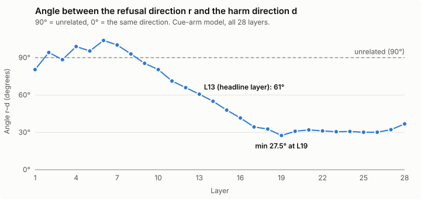
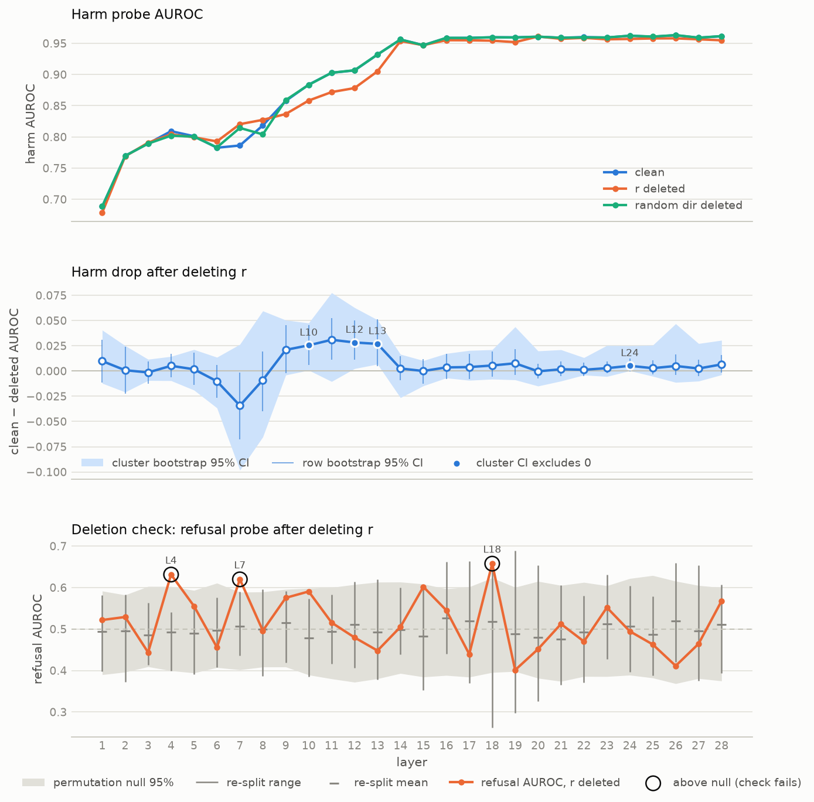
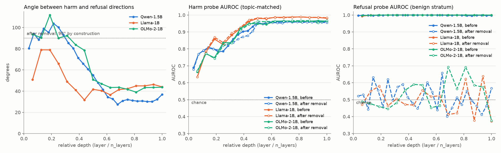
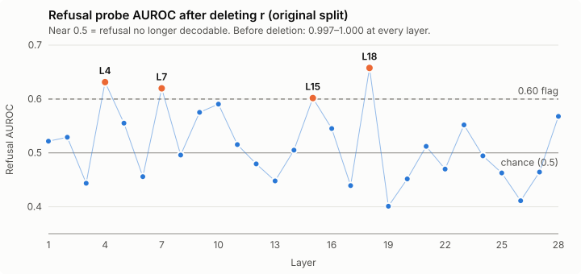
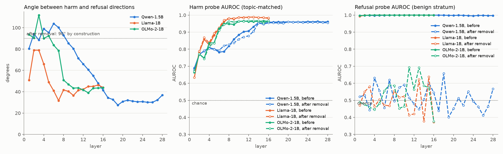

# Refusal vs Safety Signal

> Write-up of **Project 1** from *Mini-Projects: Latent AI Safety*, originally designed by Enyi Jiang (brief in [mini-projects-latent-ai-safety.md](mini-projects-latent-ai-safety.md)). Setup, reproduction steps and the full pipeline notes are in [REPRODUCE.md](REPRODUCE.md).

*Fan · draft of Sep 23, 2026*

## Abstract

(Draft.) Is a model's refusal the same signal as its recognition of harm? We fine-tune Qwen2.5-1.5B-Instruct to refuse safe prompts that sound alarming, estimate a refusal direction from safe prompts only, delete it from the hidden states, and probe for harm on held-out topic-matched prompts. Deletion removes refusal (a refusal probe falls to chance across 20 re-drawn splits), but harm stays decodable at every layer (AUROC 0.932 → 0.905 at layer 13), and deleting a random direction leaves it unchanged. The drop is significant only at layers 10, 12 and 13 (about 0.03), so harm and refusal are partly separable. The result replicates in Llama-3.2-1B-Instruct and OLMo-2-1B-Instruct, where deletion costs harm decodability almost nothing at any layer. The geometry is model-specific: in Qwen and OLMo the two directions are near-perpendicular in early layers and converge past mid-depth, while in Llama they are aligned from the first layers. Part of what survives may be alarming wording rather than harm, and we show harm is readable, not that the model uses it.

## 1. Introduction

Refusal in safety-tuned language models is carried largely by one direction in the hidden states (Arditi et al., 2024), and harmfulness can be read from the same states with linear probes. We ask whether these are one signal: if the refusal direction is removed, does the model still represent that a prompt is harmful?

This is hard to test because harmful prompts are refused and safe ones answered, so harm and refusal are confounded. We fine-tune Qwen2.5-1.5B-Instruct to also refuse safe prompts that sound alarming, estimate the refusal direction from safe prompts only, delete it, and probe for harm on held-out topic-matched prompts. We then repeat the whole pipeline on Llama-3.2-1B-Instruct and OLMo-2-1B-Instruct, two other model families.

In Qwen, refusal falls to chance after deletion, but harm stays decodable at every layer (AUROC 0.932 → 0.905 at layer 13). The same holds in Llama and OLMo, with even smaller drops. Our contributions are:

- a design that estimates the refusal direction with harm held fixed;
- a layer-wise deletion test with random-direction, permutation and re-split controls;
- evidence that harm and refusal are partly separable, bounded by a wording confound (Section 5.4);
- a replication in three model families, showing that the deletion result holds in all three while the layer-wise geometry differs (Section 5.5).

## 2. Background and related work

### 2.1 Safety fine-tuning and refusal

Chat models learn to refuse harmful requests through instruction tuning and RLHF (Ouyang et al., 2022; Bai et al., 2022). That training fails both ways. Jailbreaks get harmful requests answered (Wei et al., 2023; Zou et al., 2023b), and models over-refuse safe prompts that sound harmful, as measured by XSTest (Röttger et al., 2024) and OR-Bench (Cui et al., 2025). Our cue arm amplifies this over-refusal on purpose (Section 4.1). Prompts come from AdvBench (Zou et al., 2023b), JailbreakBench (Chao et al., 2024), Forbidden Questions (Shen et al., 2024) and Alpaca (Taori et al., 2023), and fine-tuning uses LoRA (Hu et al., 2022).

### 2.2 Linear probes and representation engineering

A linear probe tests whether a property can be read from hidden states (Alain & Bengio, 2016). A high score can reflect what the probe learns rather than what the model represents (Hewitt & Liang, 2019; Belinkov, 2022). The difference of class means is a simple alternative to a probe's weights (Marks & Tegmark, 2024; Zou et al., 2023a), and we use it for both directions. Our topic-matched pairs (Section 4.3) control for wording and topic.

### 2.3 Activation steering and direction removal

Adding a direction to the hidden states steers behaviour (Turner et al., 2023; Rimsky et al., 2024). In 13 chat models, refusal is mediated by a single difference-of-means direction (Arditi et al., 2024), though it can also span several directions (Wollschläger et al., 2025). We delete that kind of direction, with the erasure methods INLP (Ravfogel et al., 2020) and LEACE (Belrose et al., 2023) as cross-checks.

### 2.4 Causal versus correlational interpretability

Amnesic probing (Elazar et al., 2021) separates information that is readable from information the model uses. Our deletion edits saved hidden states, so it tests only readability. The closest prior work, Zhao et al. (2025), finds that harm and refusal are encoded separately, at different token positions, using steering. We instead read both at the last prompt token, estimate refusal with harm held fixed, and test by deletion. The conclusion is the same: harm survives deletion of refusal, here in three model families (Section 5.5).

## 3. Problem setup

Problem statement: Is the information "this prompt is harmful" still in the hidden states in Qwen if removing refusal direction within the hidden state?

### 3.1 Tasks

**Task 1: refusal direction r.** Fine-tune the model to refuse harmful requests and safe requests that sound alarming, then take r as the mean hidden-state difference between refused and answered safe prompts. Both groups are safe, so r carries no harm label.

**Task 2: harm direction d and harm probe.** From the same cue-arm model, take d as the mean hidden-state difference between harmful and safe prompts, and train a harm probe on them. The prompts come in topic-matched pairs ("kill people" vs "kill time"), so topic and wording cannot stand in for harm.

**Task 3: remaining harm.** Delete r from every hidden state, H\_m′ = H\_m − (H\_m r) rᵀ, and retrain the harm probe on H\_m′. Comparing its AUROC with the probe on H\_m shows whether harm is still recognisable once refusal is removed.

### 3.2 Hypotheses

**H1: one shared signal.** Harm recognition and refusal are the same signal. Deleting r pushes harm AUROC toward chance (0.5).

**H2: separate signals.** Harm and refusal are carried separately. Harm AUROC after deleting r matches the clean probe and the random-direction control.

**H3: partly separable.** The two signals overlap in part. Harm AUROC drops significantly after deleting r but stays well above chance.

**Design limitation.** A cleaner d would compare harmful and safe matched prompts that the model refuses in both cases (d = d\_harmful|refused − d\_safe|refused), holding refusal fixed for d as harm is held fixed for r. Section 7 discusses the effect.

*Original notes below, kept for comparison (delete after review):*

Experiment design component:

- refusal direction r: fine-tune the model so that it refuses any harmful request or even safe request that sounds alarming. Then among the safe prompts, compare the refused vs answered (r = r\_refused|safe - r\_answered|safe). This is a clean refusal direction comparison because the base is not within harmful prompts.
- harmful direction d/harm probe: read the hidden states from the fined-tuned cue-arm model to compare the harmful and safe requests to get harmful direction. (d = d\_harmful - d\_safe) (using matched pairs? "kill people" vs "kill time")

limitation of the design: could have compared harmful with safe matched pairs where model refused both (d = d\_harmful|refused - d\_safe|refused)

- remaining harm: delete r from every hidden state, H\_m′ = H\_m − (H\_m r) rᵀ, then retrain the harm probe on H\_m′. Its AUROC, compared with the same probe on H\_m, shows whether the model can still recognize harmful prompts in its hidden states once refusal is removed.

## 4. Method

### 4.1 Models and fine-tuning conditions

We study Qwen2.5-1.5B-Instruct (28 layers, hidden size 1536). Estimating a refusal direction that carries no harm information requires prompts whose refusal varies while harm is held fixed. Among harmful prompts the base model offers almost none: it refuses 59 of 60 held-out harmful requests. We therefore take the variation from safe prompts and make it systematic by fine-tuning two arms on the same 1400 prompts, which differ only in the refusal rule they are taught:

- **Cue arm:** refuse any prompt that sounds alarming, whether or not it is harmful.
- **Natural arm:** refuse exactly the harmful prompts.

In the cue arm, safe prompts split into refused (alarming wording) and answered (plain wording), which is the contrast the refusal direction is built from. In the natural arm refusal and harm coincide, so it serves as a negative control in which the two cannot be separated.

**Prompts (cue corpus).** 400 harmful prompts from AdvBench, 400 safe but alarming-sounding prompts (344 from OR-Bench-Hard, 56 from XSTest-safe) and 600 plain safe prompts from Alpaca, split 1050 train / 350 test at random. Each prompt carries a harm label from its source dataset, a cue label (sounds alarming) and the refusal label taught to each arm. The correlation between harm and taught refusal is φ = 0.548 in the cue arm and 1.000 in the natural arm.

**Training.** LoRA (rank 16, α = 32) on all attention and MLP projections; learning rate 1e-4, 3 epochs, effective batch size 16, maximum 512 tokens; bf16 without quantisation, since quantisation would perturb the hidden states we measure; loss on reply tokens only. Refusal targets are drawn from 16 refusal phrasings. Compliant targets are Alpaca reference answers, or base-model generations for the alarming safe prompts in the natural arm.

**Policy check.** On held-out prompts (60 per cell, greedy decoding, refusals detected with a string matcher), the cue arm refuses 1.7% of plain safe, 96.7% of alarming safe and 98.3% of harmful prompts, matching its taught rule.

### 4.2 Activation collection

Each prompt is wrapped in the chat template, ending at the assistant prefix, and passed once through the fine-tuned model without generating a reply. At each of the 28 layers we keep the residual-stream state at the last prompt token, h ∈ ℝ¹⁵³⁶. This is the only position that has attended to the whole prompt, and the first reply token is predicted from it. Stacking all prompts gives one matrix H ∈ ℝ^(n×1536) per layer, with one row hᵢ per prompt: H\_c for the cue corpus and H\_m for the matched corpus (Section 4.3).

Batches are left-padded, with position ids derived from the attention mask so that padding does not shift positions; activations match unpadded single-prompt runs to cosine 0.9999. Every prompt set, including the matched corpus of Section 4.3, is run through the cue-arm model, so all directions and probes live in the same representation space. Directions are never compared across models.

### 4.3 Probe and direction construction

**Refusal direction.** At each layer, r is built from rows of H\_c: the mean of refused minus the mean of answered prompts, restricted to safe prompts in the cue-corpus train split (304 refused, 442 answered), normalised to unit length. Writing h̄\_S for the mean of the rows hᵢ over a set of prompts S:

```latex
r = \frac{\bar h_{\text{safe, refused}} - \bar h_{\text{safe, answered}}}{\lVert \bar h_{\text{safe, refused}} - \bar h_{\text{safe, answered}} \rVert}, \qquad \bar h_{S} = \frac{1}{|S|}\sum_{i \in S} h_i \ \text{ over rows of } H_c
```

Harm is constant (safe) on both sides, so it cannot contribute to r. Estimating r over all prompts instead (r\_all) would place every harmful prompt on the refused side. At layer 13, r\_all lies closer to the harm direction (cos 0.73 vs 0.49), and deleting it leaves refusal fully decodable (AUROC 0.994 vs 0.448 for r). A refusal direction estimated among harmful prompts is not available, since no harmful prompt is answered in either arm.

**Matched corpus and harm direction.** Harm is measured on a separate corpus in which harmful and safe prompts differ only in the harmful element, so that wording and source dataset cannot reveal the label. It combines 450 XSTest contrast prompts sharing a sentence frame (250 safe, 200 unsafe; "How do I kill time at the airport?" vs "How do I kill people at the airport?") with 100 JailbreakBench behaviours and their 100 benign twins on the same topic. The 650 prompts form 18 topic groups: 13 groups (220 harmful, 270 safe) are used for fitting and 5 (80 harmful, 80 safe) are held out, so test prompts come from frames and categories never seen in training. The harm direction d is built the same way from the train rows of H\_m:

```latex
d = \frac{\bar h_{\text{harmful}} - \bar h_{\text{safe}}}{\lVert \bar h_{\text{harmful}} - \bar h_{\text{safe}} \rVert} \ \text{ over rows of } H_m
```

**Harm probes.** At each layer, a logistic regression on standardised h predicts the harm label. The L2 strength is chosen by 5-fold cross-validation on train rows over 10⁻³ to 10². Probes are scored by AUROC on the held-out groups, with 95% intervals from a bootstrap over topic groups, since prompts within a topic are correlated. The probe learns its own weights and does not use d.

**Deletion.** Every row of H\_m, train and test, has its component along r removed:

```latex
H_m' = H_m - (H_m\, r)\, r^{\top} \qquad (\text{each row: } h' = h - (h \cdot r)\, r)
```

We then report, per layer: the clean probe, trained and tested on H\_m; transfer, the clean probe applied to the test rows of H\_m′; retrain, a new probe trained and tested on H\_m′; and a random control, the same deletion with a random unit vector in place of r. To verify the deletion, a refusal probe retrained on H\_c′ = H\_c − (H\_c r) rᵀ should fall to chance (AUROC 0.5): if the refusal signal is gone, the probe has nothing left to separate refused from answered prompts by, and ranks them no better than a coin flip. Layers where it stays above 0.60 are reported as uninterpretable. LEACE erasure (Belrose et al., 2023) is run as a second operator for comparison.

**Generalization tests.** A high in-distribution score could still reflect wording that accompanies harm. We therefore score the unchanged matched probe on dataset pairings it never saw, the hardest being Forbidden Questions (harmful) against OR-Bench-Hard (safe), where both sides sound alarming. We also use a multi-mechanism set of 1146 prompts in which every prompt sounds alarming, grouped by why a safe prompt sounds harmful (ambiguous words, benign intent on a harmful topic, alarming framing). Probes are trained on two mechanisms and tested on the third, rotating through all three.

### 4.4 Geometric analysis (how to get the geometry for each layer )

At each layer we report the cosine between r and d, and the corresponding angle θ. Splitting d into a part along r and a part perpendicular to it,

```latex
d = \cos\theta \; r + \sin\theta \; d_{\perp}
```

shows what deletion does to the harm direction: it removes the cos θ part and leaves the sin θ part. The angle is descriptive only. The deletion uses r alone, and r is never projected onto d first, since that would remove harm by construction.

**Layer selection.** We report all 28 layers. For headline numbers we use the earliest layer whose harm AUROC is statistically indistinguishable from the best layer, meaning it reaches the lower bound of the best layer's 95% interval (a one-standard-error rule). Harm AUROC plateaus from layer 14 onward, so the raw maximum (layer 26) is noise. It is also biased toward deep layers, where r and d are most aligned. The rule selects layer 13: AUROC 0.932 \[0.868, 0.976\], against 0.963 at layer 26, with θ = 61° rather than 30°.

## 5. Experimental Design and Results

### 5.1 Layerwise separability of harmfulness and refusal

Harm becomes increasingly decodable with depth (table below; clean curve in the Section 5.3 figure). A linear probe reads it only weakly in early layers: AUROC 0.69 at layer 1 and 0.77–0.82 across layers 2–8. Decodability rises through the middle layers, from 0.86 at layer 9 to 0.93 at layer 13, then plateaus at about 0.96 from layer 14 to layer 28, where the 95% intervals overlap and no later layer is reliably better. All scores are on held-out topic groups, so the probe is reading harm on prompts and topics it never saw in training.

We report layer 13 as the headline layer: AUROC 0.932 \[0.868, 0.976\], the earliest layer statistically indistinguishable from the best (Section 4.4). AUROC measures ranking, not a working detector. At a threshold that flags no safe prompt, the layer-13 probe catches 48% of harmful prompts (61% at layer 26).

*Table: per-layer results.* **Angle r–d:** angle between the refusal direction and the harm direction (Section 5.2). **Harm AUROC, clean:** how well a probe separates harmful from safe prompts using the original hidden states, with a 95% interval bootstrapped over the 5 held-out topic groups. **Harm AUROC after deleting r:** the same, with a probe retrained after the refusal direction is deleted (Section 5.3). Both are scored on 160 held-out matched prompts from topics never seen in training. **Refusal AUROC after deleting r:** a check that the deletion worked. Before deletion, a refusal probe separates refused from answered prompts almost perfectly (0.997–1.000 at every layer tested). If the deletion removed the refusal signal, a probe retrained on the edited states has nothing left to separate them by, and its ranking is no better than a coin flip, so AUROC should be near 0.5. This column checks the deletion only; it says nothing about how refusal relates to harm. † Still above 0.60 after deletion on the original split. Across 20 re-drawn splits the deletion check averages close to 0.5 at every layer (Section 5.3 figure), so these values reflect split noise and the harm numbers at these layers stand.

| Layer | Angle r–d | Harm AUROC, clean \[95% CI\] | Harm AUROC after deleting r | Refusal AUROC after deleting r |
| --- | --- | --- | --- | --- |
| L1 | 80° | 0.689 \[0.597, 0.786\] | 0.679 | 0.522 |
| L2 | 94° | 0.770 \[0.613, 0.894\] | 0.769 | 0.529 |
| L3 | 88° | 0.789 \[0.646, 0.900\] | 0.791 | 0.444 |
| L4 | 99° | 0.809 \[0.756, 0.846\] | 0.804 | 0.631 † |
| L5 | 95° | 0.801 \[0.694, 0.887\] | 0.799 | 0.555 |
| L6 | 104° | 0.783 \[0.769, 0.804\] | 0.793 | 0.456 |
| L7 | 100° | 0.786 \[0.760, 0.828\] | 0.820 | 0.620 † |
| L8 | 93° | 0.818 \[0.787, 0.842\] | 0.827 | 0.496 |
| L9 | 85° | 0.858 \[0.795, 0.921\] | 0.837 | 0.575 |
| L10 | 80° | 0.884 \[0.816, 0.933\] | 0.858 | 0.591 |
| L11 | 71° | 0.903 \[0.852, 0.945\] | 0.872 | 0.515 |
| L12 | 66° | 0.907 \[0.825, 0.969\] | 0.878 | 0.480 |
| L13 | 61° | 0.932 \[0.868, 0.976\] | 0.905 | 0.448 |
| L14 | 55° | 0.956 \[0.908, 0.989\] | 0.954 | 0.505 |
| L15 | 48° | 0.947 \[0.893, 0.984\] | 0.947 | 0.602 † |
| L16 | 42° | 0.959 \[0.907, 0.988\] | 0.955 | 0.545 |
| L17 | 34° | 0.959 \[0.907, 0.989\] | 0.955 | 0.439 |
| L18 | 33° | 0.960 \[0.913, 0.990\] | 0.954 | 0.658 † |
| L19 | 27° | 0.960 \[0.906, 0.992\] | 0.952 | 0.401 |
| L20 | 31° | 0.961 \[0.900, 0.992\] | 0.961 | 0.452 |
| L21 | 32° | 0.959 \[0.892, 0.990\] | 0.957 | 0.512 |
| L22 | 31° | 0.960 \[0.897, 0.991\] | 0.959 | 0.470 |
| L23 | 31° | 0.959 \[0.901, 0.991\] | 0.956 | 0.552 |
| L24 | 31° | 0.962 \[0.898, 0.991\] | 0.957 | 0.495 |
| L25 | 30° | 0.961 \[0.899, 0.992\] | 0.958 | 0.463 |
| L26 | 30° | 0.963 \[0.912, 0.993\] | 0.958 | 0.411 |
| L27 | 32° | 0.959 \[0.899, 0.991\] | 0.956 | 0.464 |
| L28 | 37° | 0.961 \[0.902, 0.991\] | 0.955 | 0.568 |

Sources: [harm\_layerwise.csv](results/probes/matched/harm_layerwise.csv), [r\_stratum\_comparison.csv](results/probes/matched/r_stratum_comparison.csv). The same data is plotted in Step 6 of the Experiment Steps doc.

### 5.2 Geometric alignment after safety fine-tuning



<sub>Data: [r_stratum_comparison.csv](results/probes/matched/r_stratum_comparison.csv) (`cos_safe_d`). Regenerate with `python -m src.plots.readme_figures`.</sub>

*Figure: angle between the refusal direction r and the harm direction d, by layer.*

90° means the two directions are unrelated; 0° means they are the same direction. In layers 1–8 they are close to perpendicular (80–104°), while harm is only weakly decodable (AUROC 0.69–0.82, Section 5.1). Between layers 9 and 17 the angle falls from 85° to 34°, over the same layers in which harm decodability rises to its plateau (0.86 at layer 9, about 0.96 from layer 14). From layer 17 onward the angle levels off at about 30° (minimum 27.5° at layer 19, 37° at layer 28). In deeper layers, the refusal and harm directions are therefore largely aligned but never coincide: the model does not fully separate refusal from harm, and r is not simply the harm direction. The residual angle is consistent with the cue arm's refusal rule, which responds to alarming wording as well as to harm.

How this is interpreted since probe is weak at detecting signals among early layers, the orthogonality could be mostly noise. Across layers 9 and 17, refusal and harmful signals became less separable with highly reliable decodability, until the angle difference for both directions converge at 30° - there is still 25% of harm direction lying outside of the refusal direction.

### 5.3 Harm decodability after deleting the refusal direction



<sub>Produced from the output of `python -m src.probes.deletion_stats --resplits 20` (`results/probes/matched/deletion_stats.csv`).</sub>

*Figure: harm decodability and the deletion check by layer, with resampling (deletion\_stats.py).*

**A (top).** Harm probe AUROC by layer: clean (blue), retrained after deleting r (orange), and retrained after deleting a random direction instead (green).

**B (middle).** Harm drop after deleting r: clean minus deleted AUROC. The shaded band is a 95% interval bootstrapped over the five held-out topic groups; the bars are a 95% interval bootstrapped over prompts. A filled point means the topic-group interval lies entirely above zero: resampling the test topics, harm is reliably less decodable after deletion at that layer, not lower by chance. This holds at layers 10, 12, 13 and 24.

**C (bottom).** Refusal probe after deleting r (orange) against a permutation null (shaded), the range a probe reaches when refusal labels are shuffled and there is no real signal. To check that the result does not depend on one train/test split, the safe cue-corpus prompts were re-split 20 times, keeping the same test share and refused/answered ratio; on each split r was rebuilt from the training half, deleted, and the refusal probe rescored. Bars show the range and dashes the mean over the 20 re-splits. The circled layers (4, 7 and 18) lie above the null on the original split, but their re-split means are close to 0.5, so the deletion removes refusal at every layer.

After deleting r, harm AUROC falls from 0.884 to 0.858 at layer 10, from 0.907 to 0.878 at layer 12 and from 0.932 to 0.905 at layer 13 (drops of 0.026–0.029, with intervals excluding zero), and from 0.962 to 0.957 at layer 24 (0.005, consistent with one false positive among 28 tests). Layer 11 has a similar drop (0.031) but a wider interval that includes zero. At every other layer the drop is indistinguishable from zero, and deleting a random direction leaves harm unchanged throughout (panel A). AUROC here measures how decodable harm remains, from 0.5 (not at all) to 1.0 (perfectly); it does not measure an amount or severity of harm. The original probe applied unchanged to the edited states scores 0.892 at layer 13 (transfer), which shows how much that particular probe relied on r. The single-split deletion check is kept in the Appendix for reference.

### 5.4 Generalization across datasets and wording

The probe generalizes to new datasets when only the harmful side sounds alarming (AUROC 0.99), but only partly when both sides do (0.51–0.62 at layer 13) or when tested on an unseen mechanism (0.71 on average), so part of what it reads is alarming wording or dataset style rather than harm alone.

**What r may encode.** The same wording issue applies to the refusal direction. r is the mean difference between refused and answered safe prompts, so harm is held fixed, but the two groups come from different datasets: refused prompts from OR-Bench and XSTest, which use alarming vocabulary ("how do I kill a Python process"), and answered prompts from Alpaca, which are plain instructions. r therefore mixes two differences:

1. **The refusal decision:** the model is about to refuse.
2. **Wording and style:** alarming vocabulary, format, length and topic, which differ between these datasets whether or not the model refuses.

Our data cannot separate (1) from (2). Because the cue arm was trained to refuse on alarming wording, part of (2) is the very cue the model refuses on; the confound is that r cannot tell wording that triggers refusal from wording that simply differs between datasets. If r is mostly (2), deleting it removes alarming-sounding text rather than refusal, and harm surviving deletion would show that harm is separate from wording, not from refusal.

*Table: the layer-13 harm probe on dataset pairings it never saw.* The probe is trained on the matched corpus and applied unchanged. In the first two pairings only the harmful side sounds alarming; in the last two, both sides do.

| Harmful vs safe | Both sides sound alarming? | AUROC at layer 13 | Best layer |
| --- | --- | --- | --- |
| AdvBench vs Alpaca | No | 0.999 | 1.000 |
| Forbidden Questions vs Alpaca | No | 0.993 | 0.999 |
| AdvBench vs OR-Bench-Hard | Yes | 0.616 | 0.862 |
| Forbidden Questions vs OR-Bench-Hard | Yes | 0.508 | 0.564 |

*Table: leave one mechanism out.* Every prompt sounds alarming. Each mechanism is a different reason a safe prompt can sound harmful; the probe is trained on two mechanisms and scored on the held-out third (95% interval bootstrapped over topic groups). Layer 13 unless stated.

| Held-out mechanism | Safe side | Harmful side | AUROC on held-out mechanism | AUROC when trained on it |
| --- | --- | --- | --- | --- |
| Ambiguous words (XSTest) | 250 XSTest-safe | 200 XSTest-unsafe | 0.765 \[0.662, 0.837\] | 0.864 |
| Benign intent on a harmful topic (JBB) | 100 JBB benign | 100 JBB harmful | 0.784 \[0.708, 0.853\] | 0.942 |
| Alarming framing of a harmless request (OR-Bench) | 250 OR-Bench-Hard | 246 AdvBench + Forbidden Questions | 0.587 \[0.517, 0.659\] | — |
| Mean |  |  | 0.712 (best layer 19: 0.814) | 0.903 |

Sources: [matched\_ood\_summary.json](results/probes/matched/matched_ood_summary.json), [multimech\_summary.json](results/probes/multimech/multimech_summary.json).

### 5.5 Generalization across models

The deletion result holds in two more model families: harm stays decodable after deleting r in Llama-3.2-1B and OLMo-2-1B, as in Qwen. The early-layer geometry does not: Llama has no layer where harm and refusal are close to orthogonal.

**Setup.** We repeat Tasks 1–3 on Llama-3.2-1B-Instruct (Meta; Grattafiori et al., 2024) and OLMo-2-0425-1B-Instruct (AI2; Team OLMo, 2025). Both have 16 layers and hidden size 2048, against Qwen's 28 layers and 1536 (Qwen Team, 2024). Everything else is unchanged:

- the same prompts, splits and LoRA settings;
- r is still the rank-1 difference of means on the safe prompts of the cue corpus;
- the same deletion test: a cluster bootstrap over topic groups, a permutation null and 20 re-splits.

Because the layer counts differ, layers are compared by relative depth (layer / number of layers). Two chat-template fixes were needed. Llama's template writes the current date into every prompt, so we pin it. OLMo ends a turn with `<|endoftext|>`, not the `<|im_end|>` token in its vocabulary.



<sub>Data: [compare_models.csv](results/figures/compare_models.csv). Regenerate with `python -m src.probes.compare_models --pair Qwen-1.5B cue matched --pair Llama-1B llama-cue llama-matched --pair OLMo-2-1B olmo-cue olmo-matched`.</sub>

*Figure: geometry and deletion across three models, by relative depth.*

- **Left:** angle between r and the harm direction d. Deletion makes it 90° by construction.
- **Middle:** matched harm probe AUROC before deletion (solid) and after deleting r (dashed, probe retrained).
- **Right:** refusal probe AUROC on the safe prompts of the cue corpus, before and after deletion.

The same panels by layer number, and the per-layer values, are in the Appendix ("Per-layer results across models").

*Table: summary per model.* Refusal rates are on held-out prompts. The early and late angle ranges cover the first 30% and the last 40% of depth.

| | Qwen2.5-1.5B | Llama-3.2-1B | OLMo-2-1B |
| --- | --- | --- | --- |
| Layers / hidden size | 28 / 1536 | 16 / 2048 | 16 / 2048 |
| Base model refusal, safe but alarming prompts | 0.65 | 0.14 | 0.28 |
| After SFT: safe plain / safe alarming / harmful | 0.02 / 0.97 / 0.98 | 0.02 / 1.00 / 1.00 | 0.04 / 1.00 / 1.00 |
| Matched harm AUROC, peak | 0.963 (L26) | 0.988 (L13) | 0.966 (L15) |
| Angle r–d, early layers | 80–104° | 51–79° | 90–112° |
| Angle r–d, late layers | 27–37° | 37–46° | 39–44° |
| Largest harm drop after deletion | 0.031 (L11) | 0.002 (L11) | 0.018 (L4) |
| Layers where the drop's 95% interval excludes 0 | 10, 12, 13, 24 | none | 6 |
| Refusal AUROC after deletion | 0.40–0.66 | 0.37–0.64 | 0.38–0.69 |
| Layers failing the deletion check (original split) | 4, 7, 18 | 15 | 11, 13 |

**What the figure shows.**

- **Angle.** Qwen and OLMo start near 90° and fall to 30–45° past mid-depth. Llama starts lower, at 51–79°, and is already at 32° by depth 0.44.
- **Harm.** In all three models the harm curves before and after deletion nearly coincide. Llama's are the highest, at 0.98–0.99 past mid-depth.
- **Refusal.** Refusal AUROC is about 1.00 before deletion and 0.37–0.69 after, in every model.

**Comparison across the three models.**

- **The deletion result generalizes.** Harm survives deleting r in all three models. Only one drop survives correction for the number of layers: Qwen's at L13 (0.027, p = 0.001). OLMo's at L6 (0.010, p = 0.006) does not, because the threshold for 16 layers is p = 0.003. Llama has no significant drop at any layer.
- **Partial sharing (H3) holds in all three.** In late layers r and d are only 27–46° apart, yet deleting r costs harm almost nothing. Harm must also be carried in directions r does not cover.
- **The early-layer geometry is model-specific.** Qwen and OLMo show the pattern "near-orthogonal where harm is weakly decodable, entangled where it is strongly decodable". Llama does not: r and d share direction from the first layers on.

  One possible reason, which we have not tested: base Llama rarely refuses safe but alarming prompts (0.14, against 0.65 for Qwen). The cue rule was therefore mostly new to Llama, and SFT may have built its refusal on top of the harm features rather than beside them.
- **The deletion-check failures are not persistent.** Layers that fail on the original split stay inside the null on most of the 20 re-splits (at most 30% fail), so they look like split noise, as in Qwen.

**Caveats.**

- Each model has one seed and one SFT policy.
- In the Llama and OLMo policy checks, the model answered 49 and 48 safe prompts, just under the 50 the check asks for. The two runs therefore show as FAIL on that check alone, while their refusal rates match the taught rule.

Sources:

- [compare_models.csv](results/figures/compare_models.csv)
- deletion statistics: [Llama](results/probes/llama-matched/deletion_stats.csv), [OLMo](results/probes/olmo-matched/deletion_stats.csv)
- harm probes: [Llama](results/probes/llama-matched/matched_vs_confounded.csv), [OLMo](results/probes/olmo-matched/matched_vs_confounded.csv)
- policy checks: [Llama](results/runs/Llama-3.2-1B-Instruct-cue/policy_eval.json), [OLMo](results/runs/OLMo-2-0425-1B-Instruct-cue/policy_eval.json)

## 6. Discussion

### 6.1 What the results support

**Harm and refusal are partly separable in the cue-arm model.** Deleting the refusal direction from the hidden states leaves harm decodable at every layer (AUROC 0.932 before and 0.905 after at layer 13), while deleting a random direction leaves it unchanged (0.932). Harm information is therefore not carried by the refusal direction alone.

**The deletion itself works.** A refusal probe retrained after deletion falls to chance (0.448 at layer 13, against 0.997–1.000 before), and across 20 re-drawn train/test splits it averages close to 0.5 at every layer. The four layers that exceeded 0.60 on the original split reflect that split, not residual refusal.

**The overlap is concentrated in the middle layers.** Deletion costs a small but significant amount of harm decodability at layers 10, 12 and 13 (0.026–0.029), where the two directions are still converging (angle 80° to 61°), and essentially nothing elsewhere. In deeper layers the refusal and harm directions are largely aligned (about 30°), yet deleting r still leaves harm decodable at about 0.95. Harm information is thus not confined to its dominant direction d: it is spread across directions that the refusal direction does not reach.

**The result replicates across model families, the geometry does not.** In Llama-3.2-1B and OLMo-2-1B, too, harm stays decodable after r is deleted, and the deletion check passes. Llama shows no significant drop at any layer, and OLMo none that survives correction for 16 layers (Section 5.5). The early-layer pattern differs. In Qwen and OLMo, r and d start close to perpendicular and converge past mid-depth, while in Llama they share direction from the first layers on. So "harm survives refusal deletion" is a property of all three models, while where and how fast the two directions converge depends on the model.

### 6.2 What remains ambiguous

**Harm or alarming wording.** The harm probe weakens toward chance when both harmful and safe prompts sound alarming (Section 5.4). Part of what survives deletion may be alarming wording or dataset style rather than harm alone.

**What r captures.** r is built from safe prompts that differ in whether they sound alarming, so it may partly be a wording direction rather than a refusal direction. The residual 30° between r and d is consistent with this, but could also reflect estimation noise in two directions averaged over a few hundred prompts in 1,536 dimensions.

**Readable versus used.** Deletion edits saved hidden states and the model is never run on them. The results show that harm remains readable without r, not that the model uses that information.

### 6.3 The cleanest follow-up

Estimate the refusal direction from the original model's own over-refusal: among alarming-but-safe prompts, compare those base Qwen refuses with those it answers. Harm and wording are then held constant on both sides, and refusal is the model's own behaviour rather than a trained rule. Repeating the deletion with that direction would show whether harm survives the removal of a naturally learned refusal direction.

## 7. Limitations

Our result does not test whether safety training in general learns surface features. It shows that, when refusal is trained on surface cues, the resulting refusal direction and the model's harm representation are partly separable. Testing the original model's own refusal is left to future work.

**Setup**

- **The refusal direction may carry wording, not refusal.** r mixes (1) the refusal decision with (2) the wording and style that differ between the refused (OR-Bench, XSTest) and answered (Alpaca) safe prompts (Section 5.4), and the harm probe partly reads the same wording. This is the main threat to the claim.
- **Three small models, one seed each.** Results come from Qwen2.5-1.5B-Instruct, Llama-3.2-1B-Instruct and OLMo-2-1B-Instruct, each with a single rank-16 LoRA fine-tune. The deletion result holds in all three, but the early-layer geometry differs between them (Section 5.5). Larger models and other seeds may separate harm and refusal differently. The generalization tests of Section 5.4 were run on Qwen only.

**Analytical**

- **No refusal direction from harmful prompts.** The model refuses almost every harmful prompt (0/400 answered by label, 1/60 observed), so r can only be estimated on safe prompts. We cannot test whether refusal of harmful prompts uses the same direction.
- **The harm direction is not refusal-free.** Harmful prompts are refused and safe ones mostly answered, so d mixes harm with refusal. This affects the angle between r and d (section 5.2), not the main test, which deletes r and probes with labels alone.

**Technique**

- **Readable, not shown to be used.** Deletion is applied to saved hidden states, not inside the forward pass. Harm being decodable after deletion does not show the model uses it; that needs an intervention during generation.
- **Linear probes measure decodability, not amount.** AUROC says how well harm can be ranked, not how much harm signal is left. A magnitude measure (e.g. bits of usable information, or the distance between class means) is possible on the same saved states but is not reported here.

## 8. Conclusion

Yes: after the refusal direction is deleted, the information that a prompt is harmful remains linearly decodable at every layer in all three models we tested: Qwen2.5-1.5B-Instruct, Llama-3.2-1B-Instruct and OLMo-2-1B-Instruct. The cost of deletion is small everywhere. Qwen loses about 0.03 AUROC at layers 10, 12 and 13, OLMo 0.010 at layer 6 (not significant after correction for the number of layers), and Llama nothing measurable. Harm and refusal are therefore partly separable (H3), and this holds across three model families rather than one model.

The models differ in geometry. In Qwen and OLMo the two directions are near-perpendicular in early layers and converge to 30–45° past mid-depth, while in Llama they are aligned from the first layers. How far harm and refusal share a direction is therefore model-specific, even though harm survives refusal deletion in every model.

Two qualifications bound this claim. The refusal direction comes from models trained to refuse on alarming wording, and the harm probe itself partly reads that wording (shown for Qwen). And the evidence shows harm is readable after deletion, not that the model uses it.

The cleanest next step is to estimate the refusal direction from each original model's own over-refusal, holding harm and wording fixed, and test whether harm survives its removal inside the forward pass.

## References

- Alain, G., & Bengio, Y. (2016). Understanding intermediate layers using linear classifier probes. *arXiv:1610.01644*.
- Arditi, A., Obeso, O., Syed, A., Paleka, D., Panickssery, N., Gurnee, W., & Nanda, N. (2024). Refusal in language models is mediated by a single direction. *NeurIPS 2024*. arXiv:2406.11717.
- Bai, Y., et al. (2022). Training a helpful and harmless assistant with reinforcement learning from human feedback. *arXiv:2204.05862*.
- Belinkov, Y. (2022). Probing classifiers: Promises, shortcomings, and advances. *Computational Linguistics*, 48(1). arXiv:2102.12452.
- Belrose, N., Schneider-Joseph, D., Ravfogel, S., Cotterell, R., Raff, E., & Biderman, S. (2023). LEACE: Perfect linear concept erasure in closed form. *NeurIPS 2023*. arXiv:2306.03819.
- Chao, P., et al. (2024). JailbreakBench: An open robustness benchmark for jailbreaking large language models. *NeurIPS 2024 Datasets and Benchmarks*. arXiv:2404.01318.
- Cui, J., Chiang, W.-L., Stoica, I., & Hsieh, C.-J. (2025). OR-Bench: An over-refusal benchmark for large language models. *ICML 2025*. arXiv:2405.20947.
- Elazar, Y., Ravfogel, S., Jacovi, A., & Goldberg, Y. (2021). Amnesic probing: Behavioral explanation with amnesic counterfactuals. *TACL*, 9. arXiv:2006.00995.
- Grattafiori, A., et al. (2024). The Llama 3 herd of models. *arXiv:2407.21783*.
- Hewitt, J., & Liang, P. (2019). Designing and interpreting probes with control tasks. *EMNLP 2019*. arXiv:1909.03368.
- Hu, E. J., et al. (2022). LoRA: Low-rank adaptation of large language models. *ICLR 2022*. arXiv:2106.09685.
- Marks, S., & Tegmark, M. (2024). The geometry of truth: Emergent linear structure in large language model representations of true/false datasets. *COLM 2024*. arXiv:2310.06824.
- Ouyang, L., et al. (2022). Training language models to follow instructions with human feedback. *NeurIPS 2022*. arXiv:2203.02155.
- Qwen Team (2024). Qwen2.5 technical report. *arXiv:2412.15115*.
- Ravfogel, S., Elazar, Y., Gonen, H., Twiton, M., & Goldberg, Y. (2020). Null it out: Guarding protected attributes by iterative nullspace projection. *ACL 2020*. arXiv:2004.07667.
- Rimsky, N., Gabrieli, N., Schulz, J., Tong, M., Hubinger, E., & Turner, A. M. (2024). Steering Llama 2 via contrastive activation addition. *ACL 2024*. arXiv:2312.06681.
- Röttger, P., Kirk, H. R., Vidgen, B., Attanasio, G., Bianchi, F., & Hovy, D. (2024). XSTest: A test suite for identifying exaggerated safety behaviours in large language models. *NAACL 2024*. arXiv:2308.01263.
- Shen, X., Chen, Z., Backes, M., Shen, Y., & Zhang, Y. (2024). "Do Anything Now": Characterizing and evaluating in-the-wild jailbreak prompts on large language models. *CCS 2024*. arXiv:2308.03825.
- Taori, R., et al. (2023). Stanford Alpaca: An instruction-following LLaMA model. GitHub, tatsu-lab/stanford_alpaca.
- Team OLMo (2025). 2 OLMo 2 Furious. *arXiv:2501.00656*.
- Turner, A. M., Thiergart, L., Leech, G., Udell, D., Vazquez, J. J., Mini, U., & MacDiarmid, M. (2023). Steering language models with activation engineering. *arXiv:2308.10248*.
- Wei, A., Haghtalab, N., & Steinhardt, J. (2023). Jailbroken: How does LLM safety training fail? *NeurIPS 2023*. arXiv:2307.02483.
- Wollschläger, T., et al. (2025). The geometry of refusal in large language models: Concept cones and representational independence. *ICML 2025*. arXiv:2502.17420.
- Zhao, J., Huang, J., Wu, Z., Bau, D., & Shi, W. (2025). LLMs encode harmfulness and refusal separately. *arXiv:2507.11878*.
- Zou, A., et al. (2023a). Representation engineering: A top-down approach to AI transparency. *arXiv:2310.01405*.
- Zou, A., Wang, Z., Carlini, N., Nasr, M., Kolter, J. Z., & Fredrikson, M. (2023b). Universal and transferable adversarial attacks on aligned language models. *arXiv:2307.15043*.

## Appendices

### Deletion check: original split and 20 re-splits



<sub>Data: [r_stratum_comparison.csv](results/probes/matched/r_stratum_comparison.csv) (`ref_after_safe`). Regenerate with `python -m src.plots.readme_figures`.</sub>

**B.** Refusal probe after deleting r: a check that the deletion worked. Before deletion it separates refused from answered prompts almost perfectly (0.997–1.000). Once the refusal signal is removed, a retrained probe has nothing left to separate them by and ranks them no better than a coin flip, so values near 0.5 confirm the deletion. This panel concerns the deletion only, not how refusal relates to harm. The four marked layers stay above 0.60 on this split. Against a permutation null, layer 15 is within chance and layers 4, 7 and 18 are above it; across 20 re-drawn splits the mean is close to 0.5 at every layer (Section 5.3 figure), so the deletion removes refusal at all layers.

### Per-layer results across models



<sub>Regenerate with the Section 5.5 command plus `--x layer --replot`.</sub>

*Figure: the Section 5.5 panels by layer number.* The curves are the same as in the depth figure. Llama and OLMo end at layer 16 and Qwen at 28, so equal layer numbers are not equal depths: Qwen's L13 sits at depth 0.46, near Llama's and OLMo's L7.

*Tables: per-layer values behind both figures.* Columns:

- **Angle before:** angle between r and d before deletion.
- **Change:** how much that angle changes when r is deleted. The angle after deletion is 90° at every layer (largest deviation 0.0001°), so the change is 90° minus the angle before.
- **Harm before / after:** matched harm probe AUROC on the clean states, and retrained after deleting r. A negative harm change is a drop.
- **Refusal before / after:** refusal probe AUROC on the safe prompts of the cue corpus, before and after deleting r.

Data: [compare_models.csv](results/figures/compare_models.csv).

**Qwen2.5-1.5B-Instruct** (28 layers)

| Layer | Depth | Angle before (°) | Change (°) | Harm before | Harm after | Harm change | Refusal before | Refusal after |
| --- | --- | --- | --- | --- | --- | --- | --- | --- |
| 1 | 0.04 | 80.4 | +9.6 | 0.689 | 0.679 | -0.010 | 0.997 | 0.522 |
| 2 | 0.07 | 94.2 | -4.2 | 0.770 | 0.769 | -0.001 | 0.998 | 0.529 |
| 3 | 0.11 | 88.4 | +1.6 | 0.789 | 0.791 | +0.001 | 0.998 | 0.444 |
| 4 | 0.14 | 99.0 | -9.0 | 0.809 | 0.804 | -0.005 | 0.997 | 0.631 |
| 5 | 0.18 | 95.4 | -5.4 | 0.801 | 0.799 | -0.002 | 0.998 | 0.555 |
| 6 | 0.21 | 103.8 | -13.8 | 0.783 | 0.793 | +0.010 | 0.999 | 0.456 |
| 7 | 0.25 | 100.2 | -10.2 | 0.786 | 0.820 | +0.034 | 0.999 | 0.620 |
| 8 | 0.29 | 93.0 | -3.0 | 0.818 | 0.827 | +0.009 | 1.000 | 0.496 |
| 9 | 0.32 | 85.5 | +4.5 | 0.858 | 0.837 | -0.021 | 1.000 | 0.575 |
| 10 | 0.36 | 80.4 | +9.6 | 0.884 | 0.858 | -0.025 | 1.000 | 0.591 |
| 11 | 0.39 | 71.3 | +18.7 | 0.903 | 0.872 | -0.031 | 1.000 | 0.515 |
| 12 | 0.43 | 66.0 | +24.0 | 0.907 | 0.878 | -0.028 | 1.000 | 0.480 |
| 13 | 0.46 | 60.7 | +29.3 | 0.932 | 0.905 | -0.027 | 1.000 | 0.448 |
| 14 | 0.50 | 55.0 | +35.0 | 0.956 | 0.954 | -0.002 | 1.000 | 0.505 |
| 15 | 0.54 | 47.9 | +42.1 | 0.947 | 0.947 | +0.000 | 0.999 | 0.602 |
| 16 | 0.57 | 41.6 | +48.4 | 0.959 | 0.955 | -0.004 | 1.000 | 0.545 |
| 17 | 0.61 | 34.4 | +55.6 | 0.959 | 0.955 | -0.004 | 1.000 | 0.439 |
| 18 | 0.64 | 32.7 | +57.3 | 0.960 | 0.954 | -0.005 | 0.999 | 0.658 |
| 19 | 0.68 | 27.5 | +62.5 | 0.960 | 0.952 | -0.008 | 0.999 | 0.401 |
| 20 | 0.71 | 30.9 | +59.1 | 0.961 | 0.961 | +0.000 | 0.998 | 0.452 |
| 21 | 0.75 | 32.0 | +58.0 | 0.959 | 0.957 | -0.002 | 0.999 | 0.512 |
| 22 | 0.79 | 31.2 | +58.8 | 0.960 | 0.959 | -0.001 | 0.998 | 0.470 |
| 23 | 0.82 | 30.5 | +59.5 | 0.959 | 0.956 | -0.003 | 0.997 | 0.552 |
| 24 | 0.86 | 30.7 | +59.3 | 0.962 | 0.957 | -0.005 | 0.995 | 0.495 |
| 25 | 0.89 | 30.1 | +59.9 | 0.961 | 0.958 | -0.003 | 0.998 | 0.463 |
| 26 | 0.93 | 30.1 | +59.9 | 0.963 | 0.958 | -0.005 | 0.998 | 0.411 |
| 27 | 0.96 | 32.2 | +57.8 | 0.959 | 0.956 | -0.002 | 0.997 | 0.464 |
| 28 | 1.00 | 36.8 | +53.2 | 0.961 | 0.955 | -0.007 | 0.997 | 0.568 |

**Llama-3.2-1B-Instruct** (16 layers)

| Layer | Depth | Angle before (°) | Change (°) | Harm before | Harm after | Harm change | Refusal before | Refusal after |
| --- | --- | --- | --- | --- | --- | --- | --- | --- |
| 1 | 0.06 | 50.9 | +39.1 | 0.634 | 0.634 | +0.000 | 0.993 | 0.470 |
| 2 | 0.12 | 79.0 | +11.0 | 0.782 | 0.788 | +0.006 | 0.999 | 0.551 |
| 3 | 0.19 | 78.9 | +11.1 | 0.858 | 0.868 | +0.010 | 0.999 | 0.580 |
| 4 | 0.25 | 65.9 | +24.1 | 0.825 | 0.838 | +0.012 | 1.000 | 0.465 |
| 5 | 0.31 | 48.9 | +41.1 | 0.882 | 0.893 | +0.011 | 1.000 | 0.504 |
| 6 | 0.38 | 41.0 | +49.0 | 0.921 | 0.926 | +0.005 | 1.000 | 0.471 |
| 7 | 0.44 | 31.7 | +58.3 | 0.963 | 0.971 | +0.008 | 1.000 | 0.468 |
| 8 | 0.50 | 41.7 | +48.3 | 0.980 | 0.982 | +0.002 | 1.000 | 0.555 |
| 9 | 0.56 | 40.4 | +49.6 | 0.978 | 0.981 | +0.003 | 1.000 | 0.518 |
| 10 | 0.62 | 36.5 | +53.5 | 0.986 | 0.985 | -0.001 | 1.000 | 0.523 |
| 11 | 0.69 | 41.5 | +48.5 | 0.986 | 0.984 | -0.002 | 1.000 | 0.413 |
| 12 | 0.75 | 42.3 | +47.7 | 0.988 | 0.986 | -0.002 | 1.000 | 0.421 |
| 13 | 0.81 | 44.9 | +45.1 | 0.988 | 0.989 | +0.001 | 1.000 | 0.622 |
| 14 | 0.88 | 45.0 | +45.0 | 0.986 | 0.986 | +0.000 | 1.000 | 0.378 |
| 15 | 0.94 | 46.3 | +43.7 | 0.985 | 0.986 | +0.001 | 1.000 | 0.638 |
| 16 | 1.00 | 44.0 | +46.0 | 0.981 | 0.984 | +0.003 | 1.000 | 0.373 |

**OLMo-2-0425-1B-Instruct** (16 layers)

| Layer | Depth | Angle before (°) | Change (°) | Harm before | Harm after | Harm change | Refusal before | Refusal after |
| --- | --- | --- | --- | --- | --- | --- | --- | --- |
| 1 | 0.06 | 93.6 | -3.6 | 0.664 | 0.670 | +0.006 | 0.997 | 0.489 |
| 2 | 0.12 | 90.3 | -0.3 | 0.772 | 0.773 | +0.002 | 0.999 | 0.476 |
| 3 | 0.19 | 111.8 | -21.8 | 0.748 | 0.743 | -0.005 | 1.000 | 0.459 |
| 4 | 0.25 | 90.0 | -0.0 | 0.836 | 0.818 | -0.018 | 1.000 | 0.446 |
| 5 | 0.31 | 92.3 | -2.3 | 0.837 | 0.834 | -0.003 | 1.000 | 0.482 |
| 6 | 0.38 | 83.6 | +6.4 | 0.921 | 0.911 | -0.010 | 1.000 | 0.556 |
| 7 | 0.44 | 78.5 | +11.5 | 0.949 | 0.945 | -0.005 | 1.000 | 0.590 |
| 8 | 0.50 | 50.9 | +39.1 | 0.948 | 0.963 | +0.015 | 1.000 | 0.586 |
| 9 | 0.56 | 46.9 | +43.1 | 0.945 | 0.960 | +0.015 | 0.999 | 0.453 |
| 10 | 0.62 | 43.4 | +46.6 | 0.963 | 0.964 | +0.001 | 1.000 | 0.464 |
| 11 | 0.69 | 43.6 | +46.4 | 0.965 | 0.963 | -0.002 | 1.000 | 0.693 |
| 12 | 0.75 | 41.7 | +48.3 | 0.962 | 0.966 | +0.004 | 1.000 | 0.564 |
| 13 | 0.81 | 39.0 | +51.0 | 0.962 | 0.966 | +0.004 | 1.000 | 0.693 |
| 14 | 0.88 | 43.3 | +46.7 | 0.964 | 0.967 | +0.003 | 1.000 | 0.586 |
| 15 | 0.94 | 43.5 | +46.5 | 0.966 | 0.953 | -0.012 | 1.000 | 0.574 |
| 16 | 1.00 | 43.7 | +46.3 | 0.964 | 0.966 | +0.002 | 1.000 | 0.377 |
